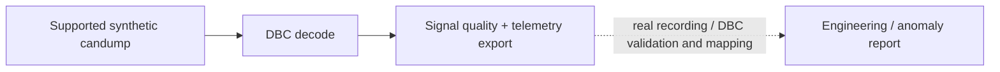
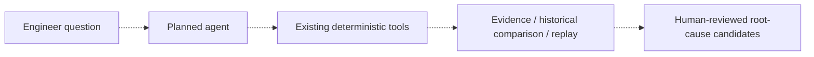
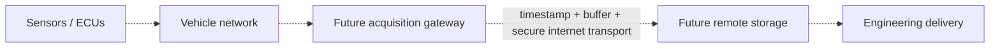

# VCAN
### Automotive Communication, Telemetry & Intelligent Diagnostics

From CAN frames to engineering insights — a modular platform for vehicle communication, measurement analysis, and automated diagnostics.


## Project overview

VCAN is a Python engineering laboratory for inspecting automotive communication
and measurement data. It addresses the practical work of decoding known CAN
messages, normalising signals, checking data quality, investigating operating
conditions, and producing reproducible reports. Two distinct paths support that
work: a virtual ECU with a verified synthetic DBC, and imported, already-decoded
vehicle telemetry with explicit source provenance. Deterministic calculations
cover vehicle dynamics, signed battery power and energy, cell measurements, and
possible recording sessions. A local dashboard and command-line tools expose the
same analysis without requiring an AI service or cloud account. The project
emphasises traceable evidence and uncertainty: it distinguishes measurement
anomalies from battery defects and inferred metadata from verified definitions.
Independent real-vehicle CAN/DBC validation is the next milestone; intelligent
investigation and connected telemetry remain planned extensions.

## Current capabilities

| Implemented foundation (v0.3) | Verified scope |
| --- | --- |
| Virtual ECU and CAN reception | Original synthetic RPM/speed/temperature, in-process virtual buses; Linux SocketCAN entry points retained |
| DBC encoding/decoding and log import | Fixed synthetic protocol, classical `candump -L`; independent byte-vector tests |
| Decoded telemetry import | Canonical CSV/JSON and profiled Excel; original cells, time, units and provenance retained for workbooks |
| Quality and engineering analysis | Independent physical/metadata/time/missingness screening; candidate states, signed power/energy, cell spreads and possible sessions |
| Delivery | Streamlit, recorded-data replay, JSON/CSV interchange and JSON/Markdown/feature-CSV engineering reports |

Rules and thresholds are screening heuristics, not a validated general-purpose
anomaly detector. Raw CAN decoding does **not** yet feed the full workbook-style
engineering-report pipeline automatically; the current paths are distinct.

## Engineering architecture

Solid paths are implemented; dashed paths are planned or optional. The six-layer
responsibility map and module dependency review are in [Architecture](docs/architecture.md).

```mermaid
flowchart LR
  V[Virtual ECU / synthetic candump] --> D[Synthetic DBC decoder]
  D --> T[TelemetrySample v1]
  F[Canonical CSV / JSON] --> T
  T --> O[Telemetry UI / JSON / CSV]
  X[Decoded Excel + explicit profile] --> R[Recording + quality]
  R --> E[Deterministic engineering analysis]
  E --> P[Dashboard / replay / reports]
  T -. v0.4 adapter and independent validation .-> R
  A[Planned diagnostic agent] -. tool orchestration .-> E
  G[Optional future gateway / remote platform] -. future ingestion adapter .-> R
  classDef planned fill:#f5f5f5,stroke:#777,stroke-dasharray:5 5;
  class A,G planned;
```

The small shared `pipeline.prepare_workbook` service prepares decoded workbooks
for both CLI and dashboard. Numerical modules remain independent of Streamlit.
No agent, forecasting model, gateway or cloud component is required or implemented.

## Core workflows

The company names below describe engineering inspirations, **not affiliation,
collaboration, endorsement, or official employer projects**. Status and acceptance
boundaries are detailed in [Workflows](docs/WORKFLOWS.md).

**A — CAN log analysis (Marquardt-inspired): partially implemented, synthetic scope**



**B — Intelligent diagnostic investigation (Bosch Rexroth-inspired): planned orchestration**



**C — Connected vehicle telemetry (Porsche-inspired): optional research track**



CAN is a vehicle communication network, not an internet transport. A vehicle ECU
network does not automatically provide a gateway or cloud connection.

## Real-world dataset investigation

The public [SCUT EV operation dataset](https://github.com/Translab-SCUT/Electric-vehicle-operation-data)
was reviewed at revision `f3bc3eb9132c46fc75e3e60662515dbaf7325c98`.
Its `vehicle#1.xlsx` contains **81,898 already-decoded observations**, not raw CAN
frames. Prior full-file checks found 700 possible sessions and 79,973 accepted /
1,924 excluded energy intervals. `MDDHHMMSS` fits the calendar/cadence evidence,
but remains **inferred**; the year/timezone, current polarity, SOC scale and some
sentinel meanings remain unresolved. No real-recording/matching-DBC validation
can be inferred from that workbook analysis.

Use **Real-World EV Dataset → Use source-reviewed SCUT profile** in the dashboard.
Metadata warnings are distinct from physical suspicion; no raw rows are deleted.
Signed energy is over accepted intervals only, not verified efficiency. The
workbook is not bundled; source/licensing details, signal mapping and reproduction
are in the [dataset guide](docs/real_world_telemetry.md) and [validation record](docs/validation.md).

## Development roadmap

| Version | Status | Milestone |
| --- | --- | --- |
| v0.3 | Implemented foundation | Synthetic CAN, decoded EV telemetry, deterministic diagnostics, UI/reports |
| v0.4 | **Next priority** | Independently validate a licensed raw recording and matching DBC |
| v0.5 | Planned | Evaluated event/anomaly detection, including message timing |
| v0.6 | Planned | Forecasting baselines and chronological held-out evaluation |
| v0.7 | Planned | Read-only, evidence-based AI tool orchestration with human review |
| v0.8 | Optional research | Buffered gateway, secure transport and remote telemetry prototype |

[Roadmap acceptance criteria](docs/ROADMAP.md) define what would justify each claim.
This restructuring milestone implements none of v0.4–v0.8.

## Validation and testing

**215 automated tests passed** in this architecture revision, retaining all 211
v0.3 tests. Coverage includes independent synthetic CAN vectors, virtual transport,
imports, uncertainty, engineering calculations, replay, exports and dashboard
integration. The latest executed environment/platform checks are recorded in
[docs/validation.md](docs/validation.md); historical SCUT results are kept separate
from any current rerun. Installation needs package access; local analysis itself
requires no AI service, internet connection, cloud platform or private dataset.

## Quick start

Requires Git and **Python 3.12**. This revision is on
`refactor/engineering-architecture-roadmap`; the validated v0.3 branch is preserved.
The version lock includes Streamlit and Excel/test dependencies. It was produced
for Python 3.12 on Linux; it is not an artifact-hash or native-Windows validation claim.

**Windows PowerShell:** use a short writable path, for example
`C:\Projects\CAN-Lab-v0.3`. These Windows commands are provided and reviewed, but
native Windows execution was not available in the Linux verification environment.
No virtual-environment activation or execution-policy change is required.

```powershell
New-Item -ItemType Directory -Force C:\Projects | Out-Null
git clone --branch refactor/engineering-architecture-roadmap https://github.com/AsherFerdinand/vcan-ecu-telemetry-dashboard.git C:\Projects\CAN-Lab-v0.3
Set-Location C:\Projects\CAN-Lab-v0.3
py -3.12 -m venv .venv
& .\.venv\Scripts\python.exe -m pip install -r requirements-lock.txt
& .\.venv\Scripts\python.exe -m pip install --no-build-isolation --no-deps -e .
& .\.venv\Scripts\python.exe -m pip check
& .\.venv\Scripts\python.exe -m pytest -ra
& .\.venv\Scripts\python.exe -m can_lab.cli demo --steps 10
& .\.venv\Scripts\python.exe -m streamlit run src/can_lab/dashboard.py --server.headless true --browser.gatherUsageStats false
```

Stop Streamlit with Ctrl+C. Optionally generate a clearly synthetic workbook and
engineering reports using fresh output filenames:

```powershell
New-Item -ItemType Directory -Force outputs | Out-Null
& .\.venv\Scripts\python.exe examples/make_ev_fixture.py outputs/synthetic.xlsx
& .\.venv\Scripts\python.exe -m can_lab.cli report-xlsx outputs/synthetic.xlsx --profile outputs/synthetic.profile.json --output-prefix outputs/report --include-features
```

**Linux/macOS shell:** the commands below are verified on Linux; macOS is not
claimed as tested. Run from a checkout of this branch:

```bash
python3.12 -m venv .venv
.venv/bin/python -m pip install -r requirements-lock.txt
.venv/bin/python -m pip install --no-build-isolation --no-deps -e .
.venv/bin/python -m pip check
.venv/bin/python -m pytest -ra
.venv/bin/python -m can_lab.cli demo --steps 10
.venv/bin/python -m streamlit run src/can_lab/dashboard.py --server.headless true --browser.gatherUsageStats false
```

The demo uses two virtual bus instances in one process; it is not physical CAN.
The [engineering guide](docs/engineering_v0.3.md#reproduce) covers reports and
Linux SocketCAN details remain in [Workflows](docs/WORKFLOWS.md#local-can-reproduction).

## Engineering documentation

| Document | Purpose |
| --- | --- |
| [Architecture](docs/architecture.md) | Six layers, actual dependencies, review findings and schema v1 |
| [Workflows](docs/WORKFLOWS.md) | Three engineering problems, implemented/planned boundaries and commands |
| [Roadmap](docs/ROADMAP.md) | v0.3–v0.8 scope and acceptance criteria |
| [Data schema](docs/architecture.md#schema-v1) / [recording mapping](docs/real_world_telemetry.md#source-mapping) | Canonical vs provenance-rich recording models |
| [Dataset guide](docs/real_world_telemetry.md) | SCUT attribution, source units and timestamp uncertainty |
| [Engineering guide](docs/engineering_v0.3.md) | Calculations, thresholds, module file map and dashboard descriptions |
| [Validation record](docs/validation.md) | Executed evidence, historical checks and unresolved limitations |
| [Earlier dataset research](docs/datasets.md) | Unverified ID.3/Taycan investigation; no vehicle adapter claims |

## Visual evidence and limitations

No genuine dashboard screenshots are stored in this repository. The tested views
are described in the [engineering guide](docs/engineering_v0.3.md#dashboard-description);
no screenshot or visual demonstration is fabricated.

Physical CAN hardware and independent real-vehicle recording/DBC validation remain
outstanding. The current codec covers the synthetic classical-CAN protocol only:
no CAN FD, Automotive Ethernet, general OEM decoder, forecasting model, AI agent,
automated root-cause system, connected gateway or cloud backend is claimed.
Screening findings are not confirmed faults or SOH estimates. A future agent would
coordinate validated tools, not replace numerical methods or human judgment.
