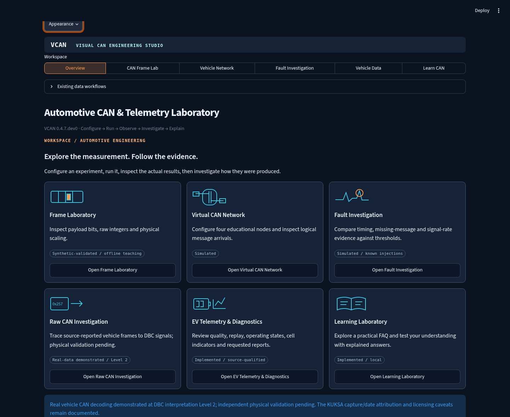
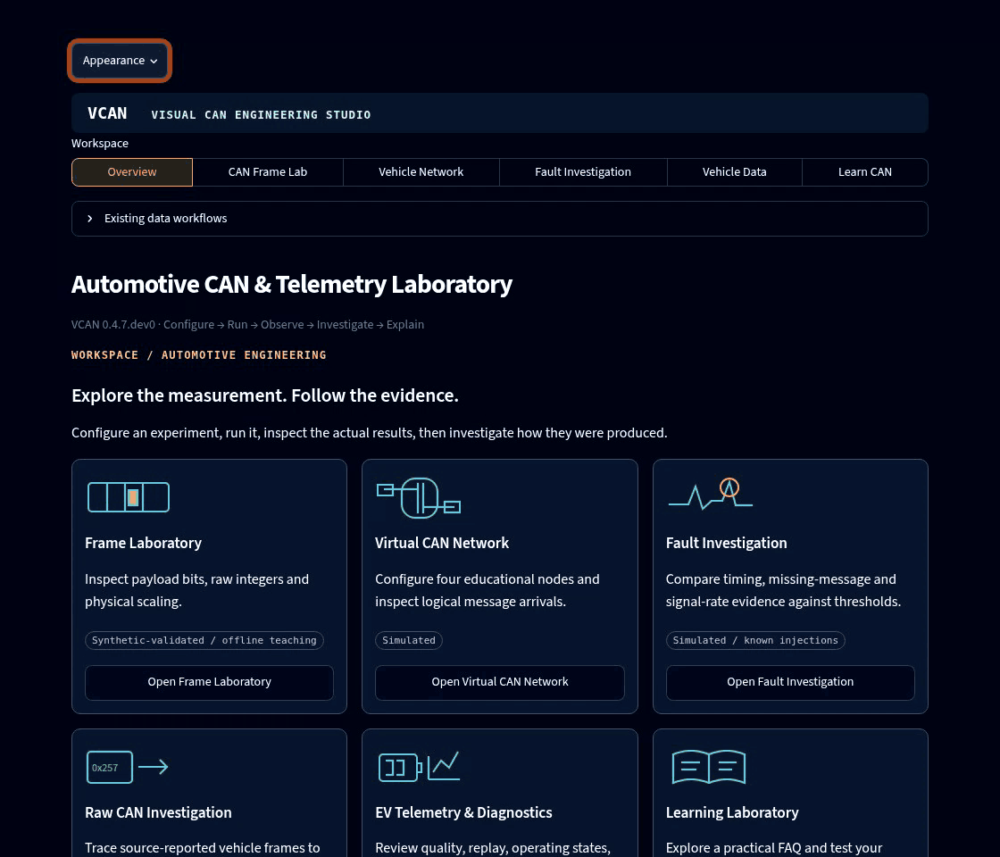
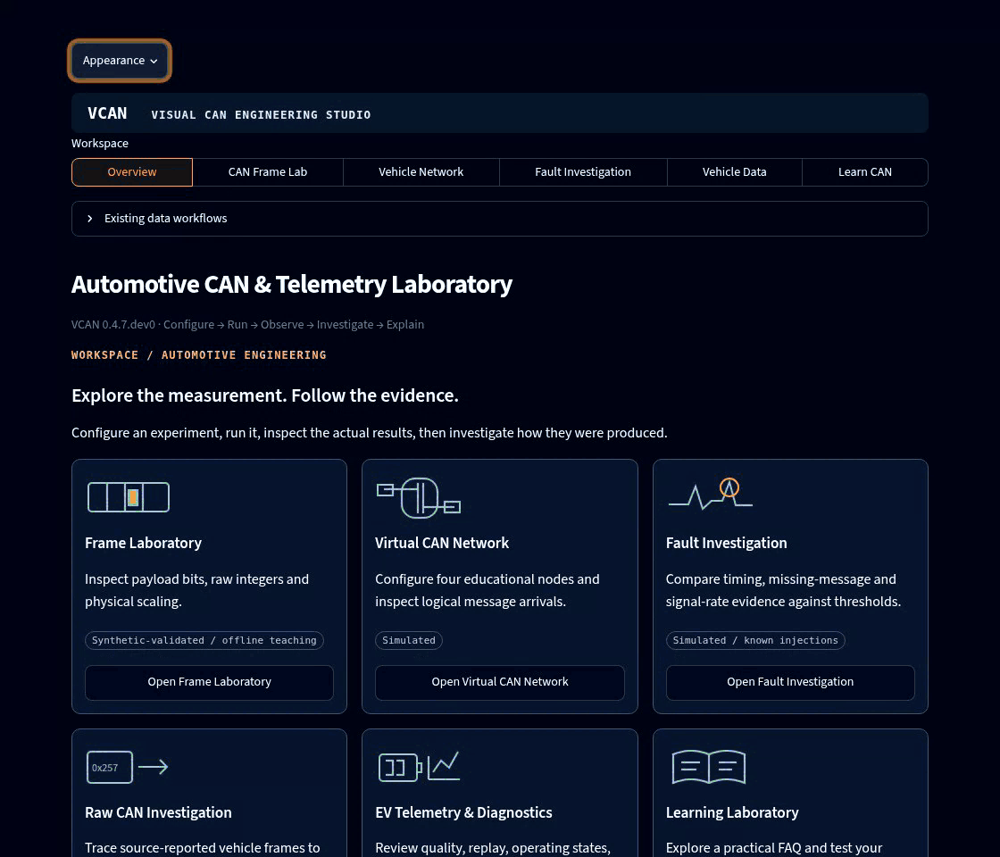
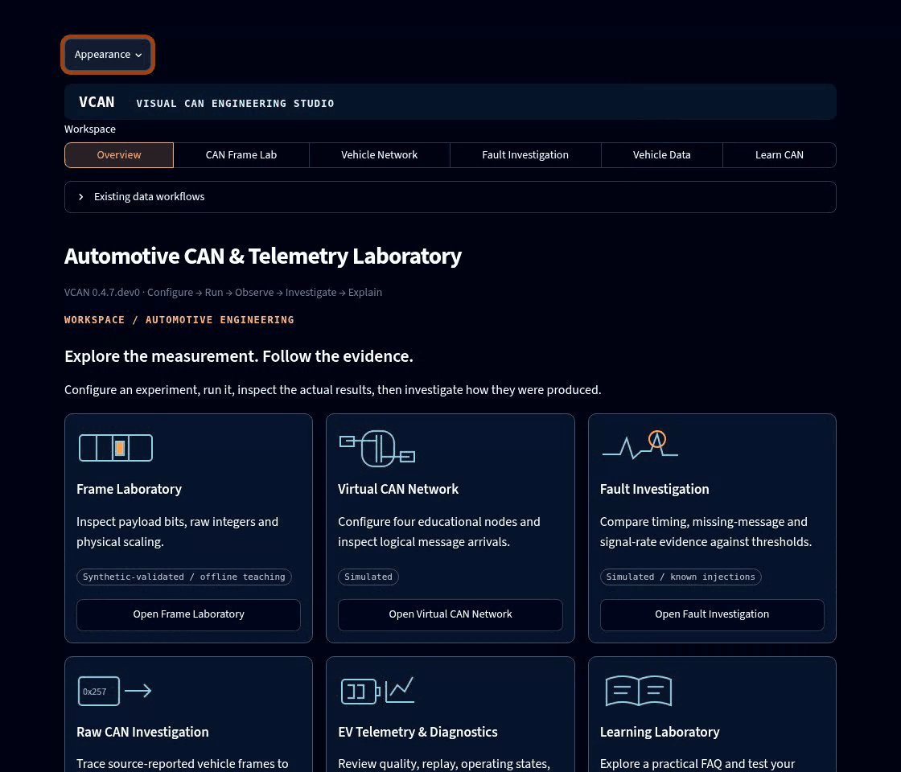
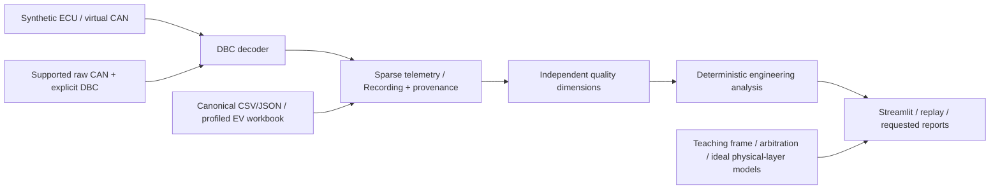

# VCAN

### Automotive CAN Engineering Studio

**Trace a CAN measurement from differential signalling to decoded telemetry—and inspect the evidence behind it.**




VCAN is a local automotive communication and telemetry laboratory. Configure an
experiment, run it, inspect the actual frames and signals, and investigate how
the result was produced. The same Python core supports virtual CAN, recorded
frames, decoded EV workbooks, quality screening, engineering analysis and reports.
No cloud account, AI API or private dataset is required to explore the studio.

## Watch the engineering

These GIFs record the **actual running application** with automated Chromium
interactions. They contain no mock screens, injected results or fabricated traffic.
[Recording method, asset verification and reproduction](docs/portfolio_recording.md).

### 1 · From payload bits to vehicle speed

Inspect the standard frame and KUKSA-derived teaching definition. Raw **538** gives
**3.04 km/h**; changing payload byte **AD → BD** gives raw **539** and **3.12 km/h**.
Reset restores the known vector. This demonstrates DBC interpretation, not a
calibrated measurement of an actual vehicle's speed.



### 2 · Follow one message across the shared bus

Play retained deterministic events through an illustrative EV architecture.
Orange transmission, cyan wire-following pulses and green receiver indications
refer to the **same frame**. Wheel and crash sensors use local links; added safety
electronics remain passive. Motion is schematic, not physical propagation or bitrate.



### 3 · Investigate bitwise arbitration

Standard data-frame contenders **0x120**, **0x124** and **0x3E0** compare identifier
bits using dominant-0/recessive-1 wired-AND. The cluster withdraws at bit 9, BMS at
bit 2, and **0x120 wins**. Losing arbitration is normal, not a communication error.



## Engineering capabilities

| Area | Implemented scope |
| --- | --- |
| CAN Frame Laboratory | Standard 11-bit classical data frames, calculated CRC-15/CAN, bit stuffing, byte/bit inspection and cantools signal decoding |
| Virtual communication | Original synthetic RPM/speed/temperature generator, python-can virtual transport and retained SocketCAN entry points |
| Vehicle network | Four deterministic publishers, bounded release schedules, event-driven SVG playback, keyboard inspection and reduced motion |
| Controlled diagnostics | Known synthetic silence, jitter and signal-step injections; thresholds and findings retain original event references |
| Recorded data | Configurable supported candump/DBC investigation, frame provenance, sparse Recording adapter, canonical CSV/JSON and profiled Excel |
| EV engineering | Separate physical/metadata/time/missingness screening; candidate operating states, qualified signed energy, cell indicators, replay and requested reports |
| Learning | 20 practical FAQ topics and a local, explained beginner/intermediate knowledge check |

Native **Light/Dark** appearance is available through the ⋮ menu. Use
**Appearance → Apply appearance** to synchronize custom visuals. Existing imports,
telemetry diagnostics and reports remain under **Vehicle Data → Existing data workflows**.
[Workbench guide](docs/workbench.md).

## Architecture



Numerical modules remain independent of Streamlit. Missing signals stay optional;
separate CAN frames are not silently aligned or forward-filled. The network's
release schedule and the bitwise identifier-arbitration experiment have distinct
assumptions. [Architecture and schema contracts](docs/architecture.md).

## Validation and real-data evidence

**375 automated tests pass**, including decoding vectors, frame/CRC/stuffing,
arbitration, ideal common-mode cancellation, event provenance, fault evidence,
imports, replay, engineering calculations, exports and frontend regressions.
Ordinary CI uses small synthetic fixtures; the external KUKSA test is optional.
Chromium checks cover genuine UI interaction, themes, motion paths, playback and
keyboard inspection. [Executed validation record](docs/validation.md).

| Evidence | What has been established |
| --- | --- |
| Synthetic fixtures | Independently specified bytes/values and deterministic software regressions |
| KUKSA source-reported vehicle CAN | **Level 2 DBC interpretation**: 10,000 frames decoded and three manual byte checks passed. Capture date/software attribution and capture-specific rights remain qualified |
| SCUT decoded EV workbook | Historical analysis of 81,898 already-decoded observations; yearless timestamp interpretation remains inferred and some units/polarity/sentinel meanings unresolved |
| Independent physical accuracy | **Pending**; neither plausible signals, a DBC nor agreement between decoders proves sensor calibration or vehicle truth |

Sources and exact revisions/hashes: [KUKSA investigation](docs/kuksa_investigation.md),
[raw-CAN validation](docs/raw_can_validation.md), [SCUT dataset guide](docs/real_world_telemetry.md).
Recordings/workbooks are not bundled. No ID.3 or Taycan adapter is advertised;
[earlier dataset research](docs/datasets.md) records the unresolved evidence.

## Run locally

Requires **Python 3.12** and Git. Run from the repository root:

```bash
git clone --branch feat/portfolio-readme-demonstrations https://github.com/AsherFerdinand/vcan-ecu-telemetry-dashboard.git
cd vcan-ecu-telemetry-dashboard
python3.12 -m venv .venv
.venv/bin/python -m pip install -r requirements-lock.txt
.venv/bin/python -m pip install --no-build-isolation --no-deps -e .
.venv/bin/python -m pytest -ra
.venv/bin/python -m can_lab.cli demo --steps 10
.venv/bin/python -m streamlit run src/can_lab/dashboard.py --server.headless true
```

These shell commands were verified on Linux. On **Windows PowerShell**, use
`py -3.12 -m venv .venv` and replace each `.venv/bin/python` with
`& .\.venv\Scripts\python.exe`; no environment activation is required. Use a short
writable checkout path. Native Windows/macOS execution is not claimed; the lock
was produced on Python 3.12/Linux.

The demo uses two virtual bus instances in one process, not physical CAN.
[SocketCAN instructions](docs/WORKFLOWS.md#local-can-reproduction) and
[workbook/report reproduction](docs/engineering_v0.3.md#reproduce) remain available.

## Scope and limitations

The studio is an engineering workbench, not production vehicle firmware or a
validated fault-diagnosis system. The configurable investigation supports only
its documented standard-ID classical integer-signal scope—not general CAN FD,
extended/multiplexed OEM decoding or Automotive Ethernet. Educational motion does
not model bus occupancy, error/retry timing, EMC or crash/braking physics.

Hardware CAN validation and independent physical references remain outstanding.
There is **no implemented AI diagnostic agent, forecasting model, cloud gateway or
automated root-cause system**. Screening findings are not confirmed battery defects,
SOH estimates or measured efficiency. Company references in the workflow guide
are inspirations, not affiliations or endorsements.

## Documentation and next milestones

| Guide | Purpose |
| --- | --- |
| [Workbench](docs/workbench.md) | Controls, teaching assumptions, FAQ/quiz and genuine screenshots |
| [Recording workflow](docs/portfolio_recording.md) | Automated browser capture, GIF verification and asset provenance |
| [Architecture / schema](docs/architecture.md) | Modules, interfaces and canonical vs provenance-rich models |
| [Workflows](docs/WORKFLOWS.md) | CAN and decoded-telemetry procedures; implemented/planned boundaries |
| [Engineering calculations](docs/engineering_v0.3.md) | Thresholds, numerical policies and reporting |
| [Validation](docs/validation.md) | Executed tests, historical findings and unresolved limitations |
| [Roadmap](docs/ROADMAP.md) | Evidence gates for evaluated detection, forecasting, AI orchestration and optional connected delivery |
| [Data / artifacts](docs/data_artifacts.md) | Retention, reproducibility, backups and read-only storage audit |

Next: resolve acquisition/reference evidence, validate native Windows/accessibility,
and evaluate production detector performance before advancing beyond teaching rules.
Keep datasets external and outputs opt-in. Audit storage without deleting evidence:

```bash
python -m can_lab.cli storage-audit --repository-root . --output-root outputs
```
