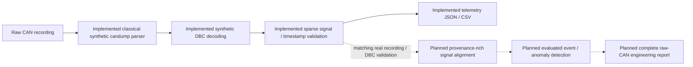
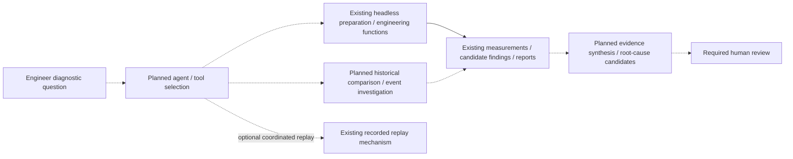
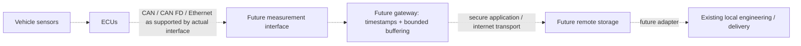

# Industry-oriented engineering workflows

These are engineering problem statements inspired by the named industries and
roles, not claims of affiliation, collaboration or endorsement by Marquardt,
Bosch Rexroth or Porsche. Implemented v0.3 capabilities are separated from planned
work. The v0.4 foundation is synthetic-validated; independent real-CAN validation
is blocked and v0.5–v0.8 remain planned.

## A. Automated CAN log analysis — Marquardt-inspired

**Problem:** manual recording inspection makes signal extraction, event review
and traceable reporting repetitive. The goal is a validated raw-frame-to-evidence
pipeline, not a claim that every DBC or vehicle format is supported already.



| Step | Current evidence / gap |
| --- | --- |
| Import | Classical `candump -L`, one channel, original synthetic standard IDs; other formats/protocols rejected |
| Decode / extract | Synthetic DBC checked against independent byte vectors; not a production-vehicle DBC |
| Time | Source timestamps preserved in v1 samples; ordering/basis validation, not multi-clock synchronisation |
| Quality | Strict frame checks and deterministic signal plausibility; unknown IDs fail explicitly |
| Export | Canonical telemetry JSON/CSV; raw identifiers/payloads remain in the original log, not a complete exported frame archive |
| Events / engineering report | Rich deterministic engineering reports exist for decoded workbooks; the new explicit raw-CAN-to-Recording adapter supports these tools, but independently validated real-vehicle evidence remains absent |

The original synthetic workflow below remains unchanged. The separate configurable
v0.4 investigation supports explicit DBC mapping, coverage counters, frame-table
provenance and sparse Recording/engineering exports, with no alignment. Follow the
[raw CAN guide](raw_can_validation.md) for the complete fixture workflow and exact
protocol/evidence limits. The table above describes the original synthetic path.

### Local CAN reproduction

After installing the pinned environment, no physical bus is needed for:

```bash
mkdir -p outputs
python -m can_lab.cli demo --steps 100
python -m can_lab.cli import tests/fixtures/synthetic.log --format candump --output outputs/synthetic-can.json
```

Create `outputs/` first and use fresh names; existing files are not overwritten.
The portable demo creates two virtual bus instances in **one process**. Those
python-can virtual buses do not communicate across independent processes.

For the retained Linux SocketCAN workflow, a suitable kernel and administrative
network permissions must supply `vcan0`:

```bash
sudo modprobe vcan
# Create only if absent:
sudo ip link add dev vcan0 type vcan
sudo ip link set dev vcan0 up
python -m can_lab.cli simulate --channel vcan0
# Separate terminal, same Python environment:
python -m can_lab.cli receive --channel vcan0
```

These are host-dependent commands, not claimed executed hardware/native-CAN
validation in this cloud review. A receiver times out after five seconds without
frames. Original `can_project/` entry points remain available. Do not transmit the
synthetic protocol onto a physical vehicle network.

Next: satisfy [v0.4 acceptance criteria](ROADMAP.md#v04--real-can-recording-validation)
with a licensed recording, demonstrably matching DBC, original evidence preservation
and selected independent signal references. Decoder self-consistency is insufficient.

## B. Intelligent diagnostic investigation — Bosch Rexroth-inspired

**Problem:** investigations span measurement tools, historical data, replay and
report writing. Future orchestration should make evidence easier to assemble,
not replace deterministic calculations or certify an unsupported fault cause.



Existing tools are ordinary Python functions, not registered agent integrations:

| Callable | What actually runs |
| --- | --- |
| `pipeline.prepare_workbook` | Import a decoded workbook, screen quality and calculate signed power |
| `engineering.analyze_engineering` | Deterministic states, cell indicators, accepted-interval energy and possible-session summaries |
| `recording_review` functions | Independent quality dimensions, raw-value review and possible-boundary evidence |
| `Replay` with `RecordingSource` | Original-order recorded replay without fabricated CAN identifiers |
| `engineering_reports` exporters | Provenance-rich JSON/Markdown and annotated feature CSV |

The CLI and dashboard already coordinate these functions. AI question routing,
a structured agent tool registry, historical-result retrieval, automated event
investigation and root-cause synthesis are **planned**, not v0.3 capabilities.
Future names in design documents are not importable placeholders.

A later agent must use explicit input/output contracts, source references,
read-only defaults, logged calls, reproducible numbers and human review. Evaluate
it against conventional scripted automation, including unsupported conclusions
and evidence coverage—not just plausible narrative output. See [v0.7](ROADMAP.md#v07--ai-assisted-diagnostic-agent).

### Existing decoded-telemetry reproduction

```bash
mkdir -p outputs
python examples/make_ev_fixture.py outputs/synthetic.xlsx
python -m can_lab.cli report-xlsx outputs/synthetic.xlsx --profile outputs/synthetic.profile.json --output-prefix outputs/synthetic-report --include-features
```

This generates synthetic data and deterministic reports, not an AI investigation.
For an independently obtained local SCUT workbook:

```bash
python -m can_lab.cli report-xlsx '/path/to/vehicle#1.xlsx' --profile src/can_lab/data/translab_scut_vehicle1_review.json --quality-config examples/scut_quality.json --engineering-config examples/engineering_config.json --output-prefix outputs/vehicle1-review
```

The profile leaves year/timezone, current polarity and SOC scale unresolved;
signed energy is not charging/discharging energy or verified efficiency. Full
interpretation/coverage rules are in [the engineering guide](engineering_v0.3.md).

## C. Connected vehicle measurement systems — Porsche-inspired

**Problem:** remote engineering depends on reliable acquisition, clock handling,
buffering, transport, storage and recovery. A functioning CAN bus alone solves
none of the internet-delivery requirements.



All gateway/remote edges are **optional future research**, not an existing VCAN
service. CAN FD and Automotive Ethernet are domain concepts here, not protocol
support claims. No live interface, precision clock synchronisation, authenticated
stream, resilient queue, remote database or cloud platform is implemented.

A prototype would need explicit acquisition and reception clocks, ordering and
clock uncertainty, bounded persistence, authenticated/encrypted transport,
connection-loss recovery and an adapter retaining raw/source provenance. Local
analysis must continue without that infrastructure. [v0.8 acceptance criteria](ROADMAP.md#v08--connected-telemetry-prototype)
cover loss, latency, ordering, time consistency and reconnect behaviour.

## Workflow boundaries that remain visible

- The SCUT workbook is **decoded telemetry**. It validates that ingestion and
  engineering path, not raw CAN decoding or a matching OEM DBC.
- Physical CAN hardware and independent real-vehicle CAN/DBC validation are
  outstanding. The synthetic DBC's independent vectors verify only its own scope.
- Screening findings and inferred operating candidates are not confirmed battery
  faults, verified vehicle efficiency or established root causes.
- No LLM dependency, agent framework, cloud account, gateway or prediction model
  is required to install and run the current local application.
