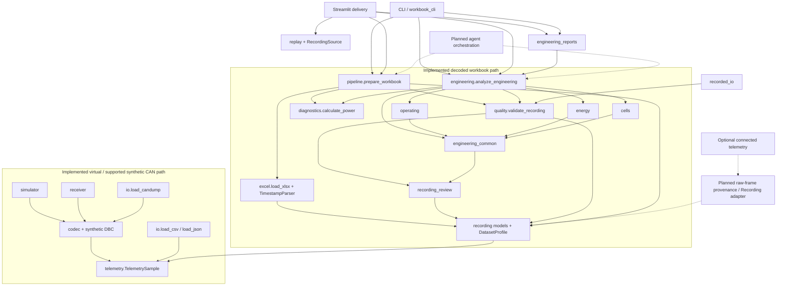

# VCAN architecture and dependency review

Baseline reviewed: v0.3.0, `792b0df6172d2bef73e27d941dc588ba2ba5268d`.
This revision preserves the package, public data models, CLI entry points and
numerical functions. Layers below describe responsibilities, not a requirement
to create six frameworks or six new package directories.

## Review findings and implemented change

The existing core is already separated from presentation. `telemetry.py`,
`recording.py`, quality/review, operating, energy, cell and session calculations
are reusable without Streamlit. Workbook import and plots carry their optional
Excel/UI dependencies; CAN tools are activated by their specific ingestion path.
Tests already exercise engineering functions without CAN or dashboard libraries.

One integration duplication was worth removing: `workbook_cli.py` and
`recorded_dashboard.py` separately loaded a workbook, applied quality screening,
and calculated signed power. Both now call the operational
`pipeline.prepare_workbook` function. This provides one testable headless
preparation contract, forwarding the same profile, sheet, limits and thresholds.
Engineering analysis remains a separate call, so changing its configuration in
the dashboard does not re-import the source workbook. No numerical method,
source profile, default threshold or output schema changed in this refactor.

There is no package-wide move, public API rename, service container, agent
framework or new runtime dependency. Existing consumers can still call the
lower-level importers/validators/calculators directly. `docs/architecture.md`
retains its name and schema anchors: a second `ARCHITECTURE.md` differing only by
case would be ambiguous on common Windows filesystems.

## Six logical layers

Target raw-data flow: acquisition → CAN decoding → signal normalisation → data
validation → engineering analysis → evaluated anomaly detection (planned) →
diagnostic investigation (planned) → visualisation/reporting. Decoded sources
bypass CAN decoding. Existing rule-based screening and reports do not imply that
the planned detector/investigation stages already operate.

| Layer | Implemented responsibility and modules | Boundary / future work |
| --- | --- | --- |
| 1. Data acquisition | `simulator.py`, `receiver.py`, `io.py`, `excel.py`; sources are virtual frames, supported logs, canonical tables and decoded workbooks | Source files remain unchanged. No connected gateway or general live-hardware acquisition service |
| 2. CAN communication and decoding | `cli.py` owns bus lifetime; `codec.SyntheticCodec`, packaged `data/synthetic.dbc`, `io.load_candump` | Classical standard-ID synthetic protocol only; real matching-DBC validation and extra formats are v0.4 work |
| 3. Normalisation and quality | `telemetry.py`, `recording.py`, `excel.TimestampParser`, `quality.py`, `recording_review.py` | Units, raw cells, clock interpretation, provenance and independent quality dimensions; no guessed metadata or automatic repairs |
| 4. Engineering analytics | `diagnostics.py`, `engineering_common.py`, `operating.py`, `energy.py`, `cells.py`, `engineering.py` | Deterministic calculations and candidate/heuristic findings; evaluated anomaly detection and forecasting remain planned |
| 5. Diagnostic automation | `pipeline.prepare_workbook` plus existing analysis/report Python functions, coordinated by CLI/UI | Current deterministic orchestration only. No question-answering agent, historical investigation store or automated root-cause system |
| 6. Engineering delivery | `dashboard.py`, `recorded_dashboard.py`, `engineering_dashboard.py`, `replay.py`, `recorded_io.py`, `engineering_reports.py`, CLI | Local UI, replay and machine/human exports; optional remote delivery is future research |

Several modules span a boundary intentionally: `excel.py` acquires source cells
and interprets explicitly configured timestamps; `io.py` contains separate table
and candump entry points. The six layers are not six serial steps for every
source. Already-decoded telemetry bypasses CAN decoding entirely.

## Actual dependency map

Solid edges below represent existing imports/calls. CAN and decoded-workbook
paths are separate. Dotted links are designs that do not currently execute.



Callers explicitly invoke engineering analysis after preparation; `pipeline.py`
does not import the engineering orchestrator. `R → T` is the explicit
`Recording.canonical_samples()` bridge, not an automatic full-fidelity conversion.
`engineering_reports` uses deterministic statistics from `engineering`; report
builders do not import Streamlit. `engineering_dashboard` consumes analysis and
report-feature APIs, and is a delivery component. `recording_plots` builds bounded,
discontinuity-safe plot data without importing Streamlit.

## Component inventory

| Requested concern | Current implementation |
| --- | --- |
| Virtual ECU simulation | `simulator.synthetic_signals`, `frames`, `simulate`; compatibility wrapper `can_project/ecu_simulator.py` |
| CAN transport / reception | `cli.demo`, `simulate`/`receive` commands own `can.Bus`; `receiver.receive`; compatibility dashboard wrapper |
| DBC decoding | `codec.SyntheticCodec` and packaged synthetic DBC; malformed/unknown frames raise errors |
| Recording import | `io.load_csv`, `load_json`, `load_candump`; `excel.load_xlsx` |
| Telemetry models | Strict sparse `TelemetrySample` v1; richer `Recording`, `Observation`, `DatasetProfile` |
| Timestamp handling | `excel.TimestampParser`; strict-series checks in `telemetry.validate_series`; independent clock review |
| Data quality | `quality.validate_recording`, `quality_summary`; `recording_review` independent dimensions and anomaly summaries |
| Engineering calculations | `diagnostics`, `operating`, `energy`, `cells`, `engineering` |
| Session segmentation | `recording_review.recording_boundaries` stores evidence; `engineering` assembles possible-session summaries |
| Recorded replay | `replay.RecordedDataSource`, `RecordingSource`, `Replay` using an explicit clock |
| Reporting / interchange | `io`, `recorded_io`, `engineering_reports` |
| Streamlit presentation | `dashboard`, `recorded_dashboard`, `engineering_dashboard` |

## Source contracts and known integration gaps

**Raw frames:** the current codec accepts only the original two synthetic,
classical standard-ID messages. `load_candump` parses `candump -L`, validates
frames, then returns sparse v1 samples. Unknown identifiers, malformed lengths,
CAN FD, RTR/error/extended frames and mixed channels are rejected, not silently
decoded or advertised as supported. The source log retains identifiers/payloads,
but v1 exported samples do **not** contain a complete raw-frame archive, channel
history or source-line back-reference. Keep the original log. A richer traceable
frame-to-signal recording contract is an explicit v0.4 acceptance requirement;
this milestone does not implement it or pretend current reports provide it.

**Decoded sources:** canonical CSV/JSON use explicit names/profiles and strict v1
validation. Workbook `Recording` retains original cells, source columns, original
timestamps, SHA-256, unit/status references and profile settings. It adds optional
normalised signals and quality annotations; the workbook path never invents CAN
identifiers. The bridge to v1 omits cell-extrema/metadata fields that v1 cannot
represent, and rejects incompatible timestamps. Use recording exports for that
full-fidelity representation. There is no automatic reverse v1-to-Recording
adapter and no end-to-end raw-vehicle-CAN engineering report yet.

**Uncertainty:** physical screening, metadata verification, timestamp validity
and missingness remain independent and may overlap. Yearless `MDDHHMMSS` is an
explicitly selected, inferred interpretation; no year/timezone is manufactured.
Measured current retains its original sign. Unverified SOC stays in source units.
See [recording details](real_world_telemetry.md) and [calculation policies](engineering_v0.3.md)
instead of duplicating their thresholds here.

## Current callable workflow (no AI required)

```python
from can_lab.pipeline import prepare_workbook
from can_lab.recording import DatasetProfile
from can_lab.engineering import analyze_engineering
from can_lab.engineering_reports import export_engineering_json

# Defaults deliberately do not infer numeric clock units or measurement units.
recording = prepare_workbook("local-recording.xlsx", profile=DatasetProfile())
analysis = analyze_engineering(recording)
with open("local-engineering-report.json", "x", encoding="utf-8") as output:
    export_engineering_json(recording, analysis, output)
```

For operational inputs use a reviewed profile and the tested commands in
[Workflows](WORKFLOWS.md). File exports require an explicit caller/writer; numerical
functions do not acquire credentials, invoke an LLM or require network access.

Future diagnostic interfaces such as event investigation, historical comparison,
anomaly detection and forecasting are requirements in [Roadmap](ROADMAP.md), not
placeholder Python functions. An eventual agent should invoke validated tools,
log evidence and defer conclusions to human review. Connected acquisition remains
an optional independent adapter; CAN communication is not cloud transport.

## Schema v1

| Field | Unit / meaning |
| --- | --- |
| `schema_version` | Integer 1 |
| `timestamp_s` | Required finite nonnegative seconds |
| `time_basis` | `relative` (one session's origin) or `unix` (UTC epoch seconds) |
| `source` | Nonempty provenance string; default `recorded-unspecified` for table imports |
| `speed_kmh` | km/h |
| `rpm` | Revolutions/minute; original synthetic engine signal, not an inferred EV motor signal |
| `battery_voltage_v` | Pack voltage, V |
| `battery_current_a` | Pack current, A; **positive discharge, negative charge/regen** |
| `soc_pct` | Percent, 0–100 |
| `battery_temperature_c` | Battery temperature, degrees Celsius |
| `ambient_temperature_c` | Ambient temperature, degrees Celsius |
| `power_kw` | Battery power, kW; positive discharge |
| `odometer_km` | km |
| `quality_flags` | List of strings; recomputed bounds flags plus preserved input flags |

Every signal is optional. A CAN engine observation has RPM/speed and no battery
values; a battery observation has temperature and no RPM/speed. No automatic
joining, resampling, differentiation, power calculation or forward filling is
performed. Do not treat nearby frame timestamps as simultaneous measurements.
An EV recording need not have RPM. Voltage, current and SOC in the bundled table
fixture are explicitly invented; they are not present in the original CAN frames.

Series timestamps must be nondecreasing and use one time basis. Equal timestamps
are allowed for independent observations. Clock reversals fail; no automatic
sorting or clock-reset correction hides recording problems. A relative session
cannot be joined to another solely on its numeric timestamps. Optional
`max_gap_s` flags gaps on the later observation. Absolute dates are not guessed
from timestamp magnitude. Strings/datetimes, timezones and clock synchronisation
require an explicit upstream adapter.

NaN, infinity, booleans and nonnumeric signals fail. Broad plausibility bounds
(e.g. SOC 0–100%, pack temperature -50–100 degC, pack voltage 0–1500 V) flag values
without silently clamping/dropping them. These are research screening heuristics,
not vehicle safety limits or sensor-validity claims. An observation without
signals is flagged `no_signals`. Input quality flags are retained, not trusted as
proof of correctness. Missing flags do not establish sensor calibration/accuracy.

## Unit normalization

Canonical input units are explicit in field names and the table above. Profiles
support milliseconds to seconds, m/s or mph to km/h, SOC fraction to percent,
mV to V, mA to A, Kelvin to Celsius, W to kW, and metres to km.
`A_charge_positive` reverses current polarity into positive discharge.
Profiles are JSON objects with `columns` (source -> canonical name) and/or `units`
(canonical name -> input unit). Unsupported conversions fail, including units
specified for a fully missing signal. No heuristic alias or magnitude detection
is used. Profile authors must establish signal meaning and polarity independently.

## Python API

```python
from can_lab.io import load_csv, export_json

with open('tests/fixtures/synthetic.csv', newline='') as recording:
    samples = load_csv(recording, max_gap_s=2)

with open('/tmp/telemetry.json', 'w') as destination:
    export_json(samples, destination)

# Downstream applications need only this standard-library module:
from can_lab.telemetry import TelemetrySample
sample = TelemetrySample(timestamp_s=0, speed_kmh=36, source='synthetic-example')
assert sample.soc_pct is None
```

## Verified synthetic DBC

`0x100` is standard ID 256, DLC 8. RPM is unsigned 16-bit big-endian in bytes
0–1 (DBC Motorola start bit 7, length 16). Speed is unsigned byte 2, km/h.
`0x200` is standard ID 512, DLC 8; temperature is unsigned byte 0, degC.
Other bytes are zero padding from the original sender. Scaling is 1 and offset 0.

Independent test vector `0BB8480000000000` means 3000 rpm, 72 km/h;
`2100000000000000` means 33 degC. Tests check exact encoded bytes as well as
decoding, so a symmetric encode/decode mistake cannot alone pass verification.
These definitions come from the original repository code, not an OEM DBC.
Unsigned temperature is intentional compatibility with that synthetic protocol.
