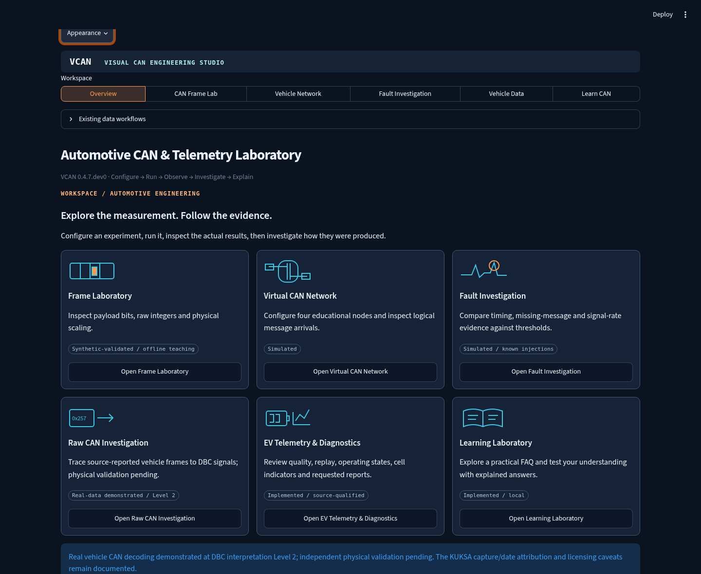
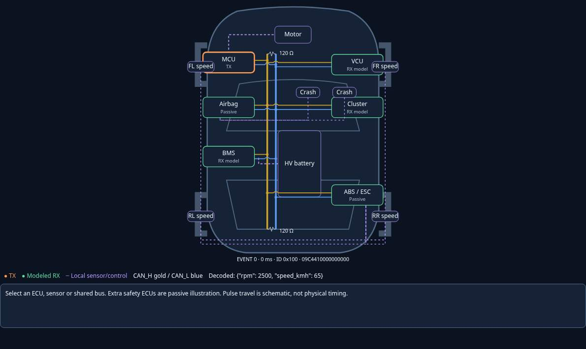
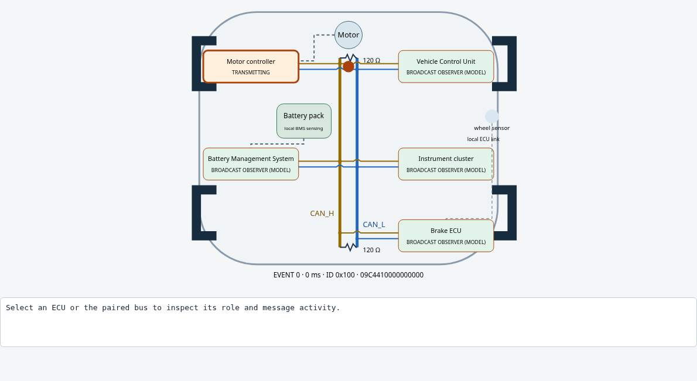
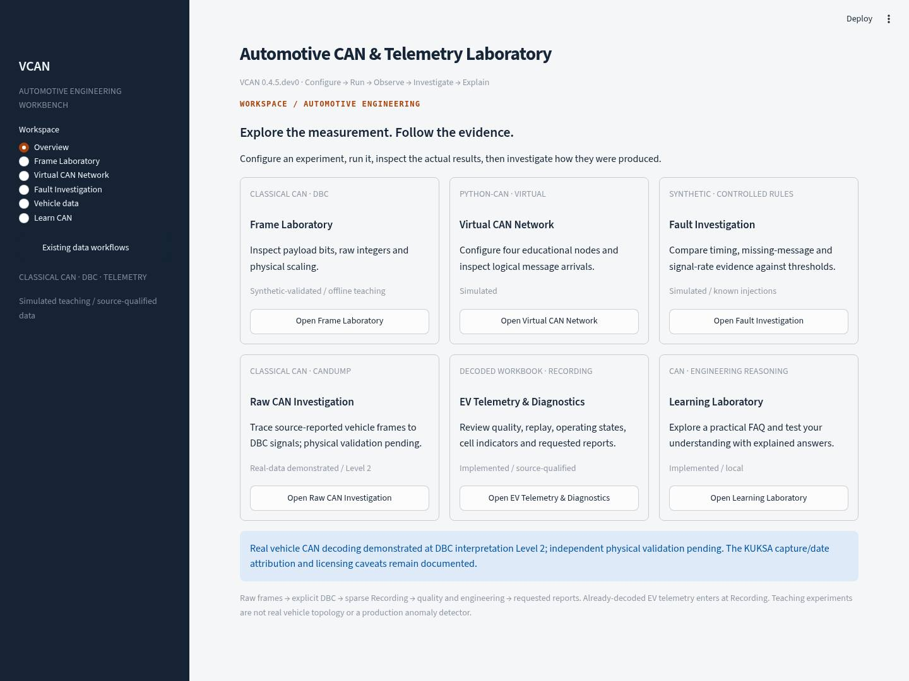
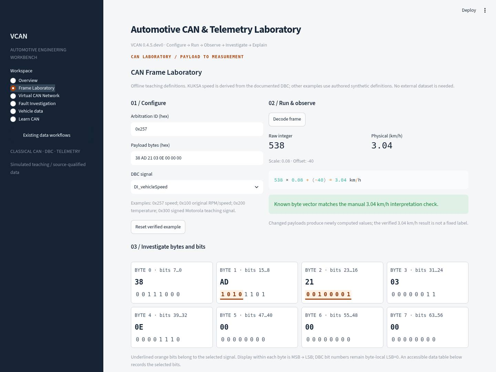

# Automotive Visual Experience — v0.4.7

The existing Streamlit application now opens on **Overview**, with a compact tab-style
navigation bar and dark navy branding, a light workspace, restrained orange accents, technical labels and
compact module cards. Configure → Run → Observe → Investigate → Explain guides
each experiment. This is the same application and analysis stack, not another
frontend. No account, network dataset, AI API or new runtime dependency is needed.
The unavailable BusBench GIF was not inspected; its written design description
informed a distinct VCAN interface without copied branding or assets.

## Start and navigate

Install the locked environment as in the README, then run from the repository root:

```bash
python -m streamlit run src/can_lab/dashboard.py --server.headless true
```

1. Open an Overview card or use the horizontal **Workspace** navigation bar.
2. Choose **Vehicle data**, then expand **Existing data workflows** above the workspace
   to select the original virtual ECU sample, synthetic candump/canonical imports,
   raw-CAN investigation or EV workbook analysis.
3. Existing workbook quality, synchronized plots, replay, engineering diagnostics
   and requested reports remain in that workflow. No source data is required to
   explore the three new experiments or Learn CAN.

Native controls retain keyboard operation and focus outlines. Bit highlights use
underlines as well as colour, and an accessible table includes every byte and
selected bit number. The layout was inspected at 1440×1080 and 1024×768 in Linux
Chromium. This is not a formal accessibility audit or native Windows/macOS test.

## Automotive visual experience

### Appearance and overview

Use the native **⋮ menu → Light / Dark** picker, then **Appearance → Apply
appearance** to synchronize custom CSS/SVG with the selected native theme.
Streamlit owns the widget, table and chart theme; VCAN reads `st.context.theme`
and stores its applied appearance within the session. The explicit Apply step
handles Streamlit's documented theme-context update delay without private frontend
APIs or global server configuration changes. Session/browser theme choice persists
while navigating. Light remains available; no custom theme service is required.

Six compact overview cards now have original inline SVG illustrations, one-sentence
purposes, capability labels, actions and hover/focus feedback. No remote images or
fonts are required. Communication is cyan/blue, TX orange, modeled RX green,
threshold evidence red and local sensor/control connections purple. Labels also
convey each state; colour is not the sole identifier.



### Vehicle layout and communication

The original top-down EV sketch positions a front motor/controller, VCU, cluster,
underfloor battery/BMS, ABS/ESC, airbag controller, four wheel-speed inputs and two
illustrative crash sensors. This is an illustrative, adaptable layout, not a Tesla
or universal production architecture. Publisher component positions/branches live
in the declarative `visual_model.LAYOUT`; changing a layout requires reviewing the
associated local sensing/power illustration as well, not treating it as OEM CAD.

**Exactly four simulated publishers remain.** Brake ECU is presented as passive
ABS/ESC; the additional airbag controller and all sensors are passive illustration.
Wheel-speed links terminate locally at ABS/ESC, crash sensing locally at airbag
control, pack sensing at BMS and the motor at its controller. Purple dashed links
are local schematic harnesses, not extra CAN nodes or a newly implemented sensor
protocol. No crash, braking, airbag deployment or sensor physics is introduced.

The gold CAN_H and blue CAN_L form one broadcast segment with two 120-ohm end
terminations. Branch crossing bridges distinguish an unconnected crossing from a
junction. Compact labels keep the drawing clear; click or press Enter/Space on an
ECU, sensor or bus for responsibilities, message IDs/periods and activity.

TX branch, both bus directions and receiver branches use SVG `animateMotion`.
The **same path geometry** draws each conductor and drives its pulse; receiver
paths are traversed in reverse. The visual event is checked against retained ID,
index, transmitter, timestamp and payload before animation. No random traffic or
new CAN frames are generated. Individual receiver pulses represent observability
of **the same frame**, not additional transmissions. New passive observations are
visual assumptions, not extra receiver queues in the original event model.

One visual cycle fits the chosen playback interval: 20% TX stub, 40% shared bus,
40% receiver stubs, then receive highlighting. These percentages are storytelling
stages, **not propagation-time, bus occupancy, latency or bitrate calculations**.
Pause fixes the selected event; returning to play rebuilds its schematic cycle.
Step/Previous/Reset select actual retained events and reset the scene. Paused and
manual reduced-motion views show static evidence without motion. OS reduced-motion
preference also hides/stops motion. No independent animation loop creates traffic.



### Fault presentation

Threshold crossings colour the original injected arrival evidence; missing-message
views add a dashed **expected release — not an observed CAN frame** annotation.
Signal discontinuities identify affected retained event indices and preserve the
previous/current decoded values and rate calculation. A known original synthetic
Powertrain ECU / 0x100 maps explicitly to the motor-controller illustration. Expand
**Mapped network evidence** to inspect its highlighted component using an actual
source event. Missing traffic never generates a replacement message. Where no
explicit mapping exists, a limitation is displayed rather than guessing from an ID.
A red rule finding remains evidence, not a physical ECU-failure diagnosis.

### Portfolio recording sequences

No GIF was generated. Suggested short manual recordings, starting from the same
installed checkout (choose a theme and Apply first):

1. **CAN Frame Laboratory (about 15 seconds).** Overview → Frame Laboratory.
   Confirm 0x257 / `38 AD 21 03 0E 00 00 00` → raw 538 → 3.04 km/h. Open advanced
   CRC/stuffing, then replace AD with BD, press Enter and show 3.12 km/h. Reset the
   verified example. Keep the field diagram and bit inspector in the recording.
2. **Vehicle propagation (about 20 seconds).** Overview → Virtual CAN Network →
   Vehicle topology. Set playback to **0.50 items/s**, Start and show the orange
   TX stub, cyan shared-bus pulses and green receiver observations. Pause; inspect
   FL speed and Airbag by click or keyboard. Step, Previous, Reset. Narrate that
   these are schematic pulses of retained events and that added safety nodes are
   passive illustration, not newly simulated traffic.
3. **Arbitration (about 15 seconds).** Vehicle Network → Arbitration, default IDs
   0x120 / 0x124 / 0x3E0. Reset. Step once to identifier bit 9 and show cluster loss.
   Step seven more times to identifier bit 2 and show BMS loss / 0x120 winner. Previous, then
   Reset. Explain normal priority contention, not a communication error or modeled
   wire occupancy. Use manual steps/reduced motion for a controlled narration.

Capture only the relevant application region; no large GIF/archive is needed.
Native Windows install, Chromium/Edge SVG/SMIL behaviour, focus handling, OS reduced
motion and laptop scaling still need a native-host validation record.

## Visual studio experiments

**CAN Frame Lab:** The field diagram is above the signal inspector. Enter a standard
11-bit ID and 0–8 payload bytes. DLC is derived from the actual payload length;
DBC decoding separately enforces its message length. Thus a shorter valid CAN
frame can be visualized while its eight-byte DBC signal correctly refuses decoding.
Select a field or hover its tile for rules, length and current bits. Intermission
is visibly separate and follows EOF. Only standard classical **data** frames are
implemented; no remote, extended, FD, error or overload frame variants are implied.

Advanced view calculates **CRC-15/CAN** over unstuffed SOF through Data, including
identifier, RTR, IDE, r0 and DLC. Polynomial is 0x4599 (x^15 implicit), initial and
final XOR zero, no reflection, MSB-first input. Stuffing then covers SOF through the
CRC sequence: insert a complement after five consecutive identical transmitted
bits. Inserted bits participate in subsequent run counting; CRC excludes them.
Delimiters, ACK, EOF and intermission are unstuffed. The known KUKSA-derived payload
has CRC 0x04CD and seven stuff bits under these explicit conventions. The check
string `123456789` gives 0x059E; separate polynomial division checks frame vectors.

The supported unstuffed field lengths are **1, 11, 1, 1, 1, 4, 0–64, 15, 1, 1, 1,
7** for SOF through EOF. Intermission contributes a further 3 bits after the frame.
A transmitter sends recessive in the ACK slot; the checkbox models a correctly
receiving peer driving dominant. ACK is not application acceptance or hardware
capture evidence. Missing-ACK errors/retries are not simulated. Native help icons
explain IDs, payloads, DLC, periods, DBC start bits and scaling.

**Vehicle Network → Arbitration:** Three standard data-frame contenders default to
0x120, 0x124 and 0x3E0. At each identifier bit (MSB first), the bus is the wired-AND
of active transmitters. A recessive transmitter observing dominant withdraws.
The cluster loses at identifier bit 9, BMS at bit 2, and 0x120 wins. Step backward,
forward, play or reset to inspect the calculation. Losing arbitration is normal,
not an error. Duplicate IDs are rejected. This lab computes actual identifier
competition; it does **not** add occupancy/latency to the separate release scheduler.

**Learn CAN → Differential signalling:** Play or step through a bounded binary
sequence. Step-after charts show original and disturbed CAN_H/CAN_L plus Vdiff.
Illustrative nominal levels are recessive 2.5/2.5 V (logical 1) and dominant 3.5/1.5 V
(logical 0). An identical deterministic sinusoidal common-mode disturbance of
0.00–1.00 V amplitude is added to both lines; subtraction cancels it in this ideal
model. Receiver range, asymmetric coupling, signal integrity and real EMC immunity
are outside scope. These are illustrative levels, not universal fixed voltages.

**Vehicle Network → Vehicle topology:** The original SVG depicts one paired CAN
segment with two end 120-ohm terminations. Four publishers and a passive Brake ECU
observe that segment; wheel sensing connects locally to Brake ECU, battery sensing
to BMS and motor power/control locally to its controller. Sensors/power components
are not extra CAN nodes. Publisher messages come from the original deterministic
network experiment, not random animation. Custom release experiments can also feed
the view. A single python-can observer validates event delivery; per-ECU receipt is
modeled broadcast observability, not separate receiver queues or hardware ACK.
There are no acceptance filters, extra segments or gateways.

Start/Pause/Previous/Step/Reset select an original retained event. Payload, DLC,
logical timestamp, transmitter, modeled receivers and original synthetic decoded
signals are inspectable. Other IDs remain uninterpreted; no unrelated teaching DBC
is silently applied. Click or keyboard-activate an ECU/bus inside the isolated HTML
component to inspect its role, messages and periods. The pulse denotes the selected
actual event, not propagation velocity. Termination and differential signalling
have contextual explanations. Disable transmission affects publishing, not the
assumed ability to observe broadcast traffic.

Playback advances **one retained item per timer tick**, at 0.50–4.00 items/s; it is
not a real-time replay clock or a wire model. Native Streamlit fragments run at a
bounded interval only while playing, stop at the buffer end and pause on navigation.
Manual reduced-motion mode disables automatic playback and CSS motion also respects
`prefers-reduced-motion`. The core's maximum 4004-event retention is unchanged.
Fault Investigation adds normal/injected arrival timelines side by side using the
same generator, while preserving all previous threshold evidence and source events.

Historical v0.4.6 Linux Chromium capture (retained engineering evidence; current v0.4.7 screenshots are above):



## Frame Laboratory

The offline KUKSA-derived speed example uses ID **0x257**, payload
`38 AD 21 03 0E 00 00 00`, start bit 12, length 12, Intel/little endian, unsigned,
scale 0.08 and offset −40. It produces raw **538**, physical **3.04 km/h**.
Edit byte AD to BD: raw becomes **539**, physical **3.12 km/h**. The interface
recalculates automatically after valid edits; Decode also provides an explicit
run action. Invalid edits clear the old result. Reset restores the example.

Inspect eight byte cells, binary values and highlighted DBC bits. Intel traverses
upward from the least significant signal bit. DBC Motorola traverses downward
from the most significant signal bit, jumping from bit 0 to bit 15 of the next
byte; it is not a reversed Intel range. The original synthetic 0x100 RPM signal
and an authored signed, cross-byte Motorola 0x300 example exercise that distinction.
`cantools` performs extraction/scaling through the existing VCAN codec loader;
the visual bit traversal is not a competing decoder.

`src/can_lab/data/education.dbc` is a small authored teaching specification. Its
speed facts derive from KUKSA's bundled DBC SHA-256
`d54df533fc82f3dab11ddd0f5ae4d846f22c0a24b111d8cba2b93e79caf60151`,
as worked in the [KUKSA investigation](kuksa_investigation.md); source spelling
`kph` is presented as equivalent `km/h`. It is not an OEM DBC, a redistributed
research recording or an independently physically verified measurement. Other
teaching definitions use the original synthetic protocol or expressly invented
signed values. Expand the calculation and evidence explanations in the module.

## Virtual CAN Network

Configure up to four educational publishers: powertrain, BMS, VCU and instrument
cluster. Set standard IDs, periods, first-release phases, enable flags, duration
and optional raw payload overrides. Default IDs 0x100 and 0x200 use the original
synthetic engine/temperature protocol; other IDs carry uninterpreted teaching
payloads. These names do not model Tesla topology or actual ECU firmware.

The presets change actual configuration: normal staggered phases, simultaneous
common-phase releases, one stopped powertrain publisher, and heterogeneous periods.
Press **Run network experiment**. Metrics, timeline, payload table and individual
event inspector reflect the completed run, not unsubmitted form edits.

The adapter reuses `simulator.frames`, `SyntheticCodec` and two `python-can`
virtual bus instances. It adds a bounded logical release schedule, not a second
signal generator or live transport implementation. Integer millisecond timestamps
are simulated; wall-clock receive timestamps are not presented as measurements.
The end time is inclusive: period 100 ms over 1000 ms produces 11 releases from
0 through 1000 ms. At most four nodes × 1001 releases = **4004 events** are retained.
Simulation durations are 100–10000 ms, periods 10–2000 ms, with no wall-clock sleeps.

Equal-time releases are sorted by ID for display only. Real standard data-frame
arbitration favours the lower ID and postpones other traffic; the workbench does
not calculate occupancy, bitrate, stuffing, delays, error frames or retries.
Duplicate transmitting IDs are rejected rather than pretending to model collisions.

## Controlled Fault Investigation

These are synthetic teaching rules, **not the evaluated v0.5 detector**. Real
recordings are never modified. The original sine-wave source remains available.

| Scenario | Computed evidence / strict threshold |
| --- | --- |
| Missing message | Stop nominal releases; compare silence through the observation horizon with expected period × multiplier |
| Timing irregularity | Add a deterministic delay to alternating releases; compare absolute inter-arrival deviation with allowed milliseconds |
| Signal discontinuity | Add an explicitly configured speed step to the original synthetic signal; compare absolute backward-difference rate with km/h/s threshold |

Equality does not exceed a threshold. Findings retain original event indices,
payloads, logical timestamps, values, intervals and thresholds. A no-arrivals case
records schedule origin and observation horizon instead of inventing a last message.
No results are saved automatically. Ground truth identifies the configured injection;
it does not turn every threshold crossing into a failed-ECU diagnosis. Logger gaps,
changed rates, clock uncertainty, normal transitions and incomplete captures are
alternative explanations in real investigations. No interpolation or automatic
repair is applied. Synthetic speed steps saturate at the original 8-bit limit 255.

## Learn CAN and Knowledge Check

Twenty FAQ expanders pair short beginner explanations with engineering detail,
including CAN/FD/OBD-II, arbitration, endian rules, message timing, provenance,
validation levels and diagnostic reasoning. Context buttons from each experiment
open Learn CAN with its topic identified. The Knowledge Check has beginner and
intermediate sets of four deterministic questions, covering eight categories.
Submit for explained feedback and score; unanswered questions receive no credit.
Hints are optional. Retry clears answers/results; changing an answer clears stale
feedback. Session state is local to the active Streamlit session, with no database,
identity collection or uploaded scores.

## Actual application screenshots

These two historical v0.4.5 JPEGs were captured from the running Linux Chromium application,
not generated mockups. Capture is deliberate documentation evidence; the app does
not export screenshots, plot images or ZIPs during normal use.





## Evidence boundaries

- **Simulated:** node releases, payload waveforms and controlled faults.
- **Synthetic-validated:** independent expected bytes/values and deterministic
  experiment regressions. Correctness of a formula is not sensor calibration.
- **Real-data demonstrated:** the separate KUKSA investigation reaches Level 2
  on a source-reported public vehicle excerpt, with documented attribution caveats.
- **Independently physically validated:** not established; remains pending.
- **Planned:** production detector evaluation, forecasting, AI and connected delivery.

Future work should first measure usability and accessibility with actual learners,
then resolve the existing acquisition/reference evidence gate. Keep evaluated
production diagnostics distinct from these learning thresholds.
